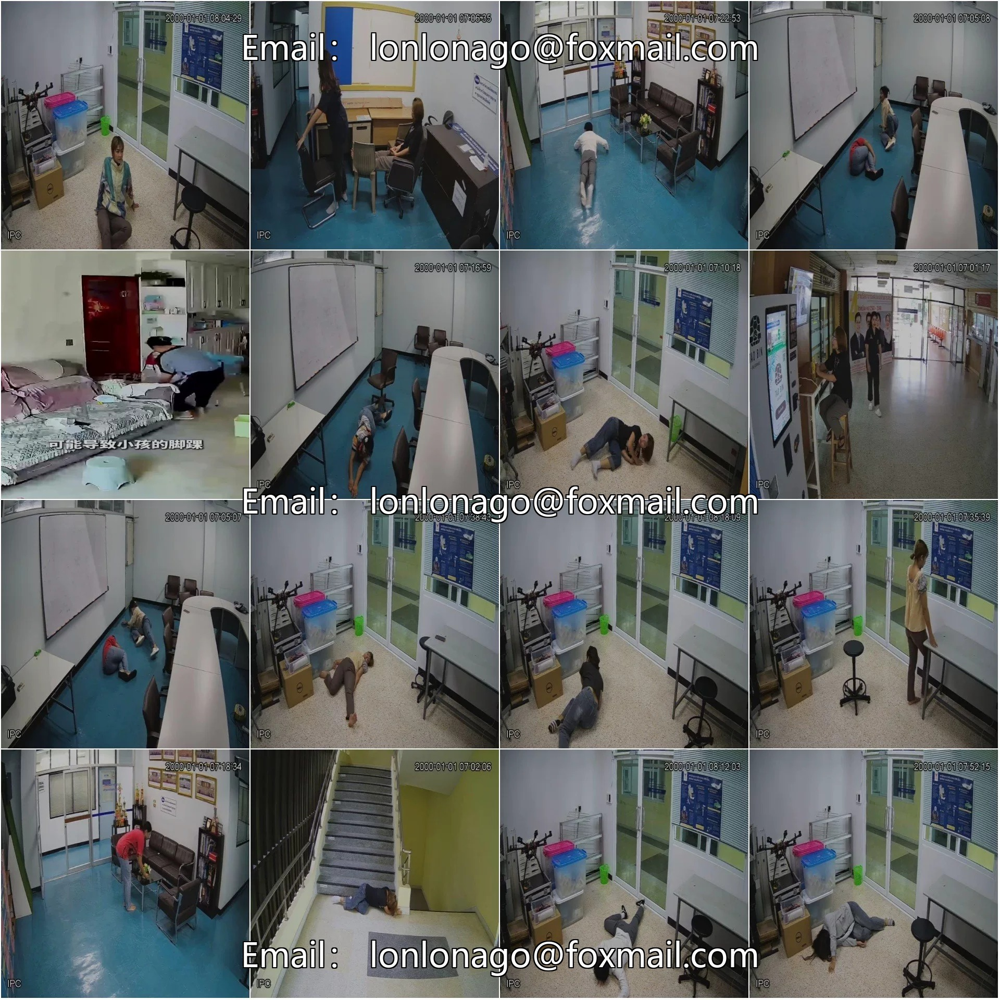
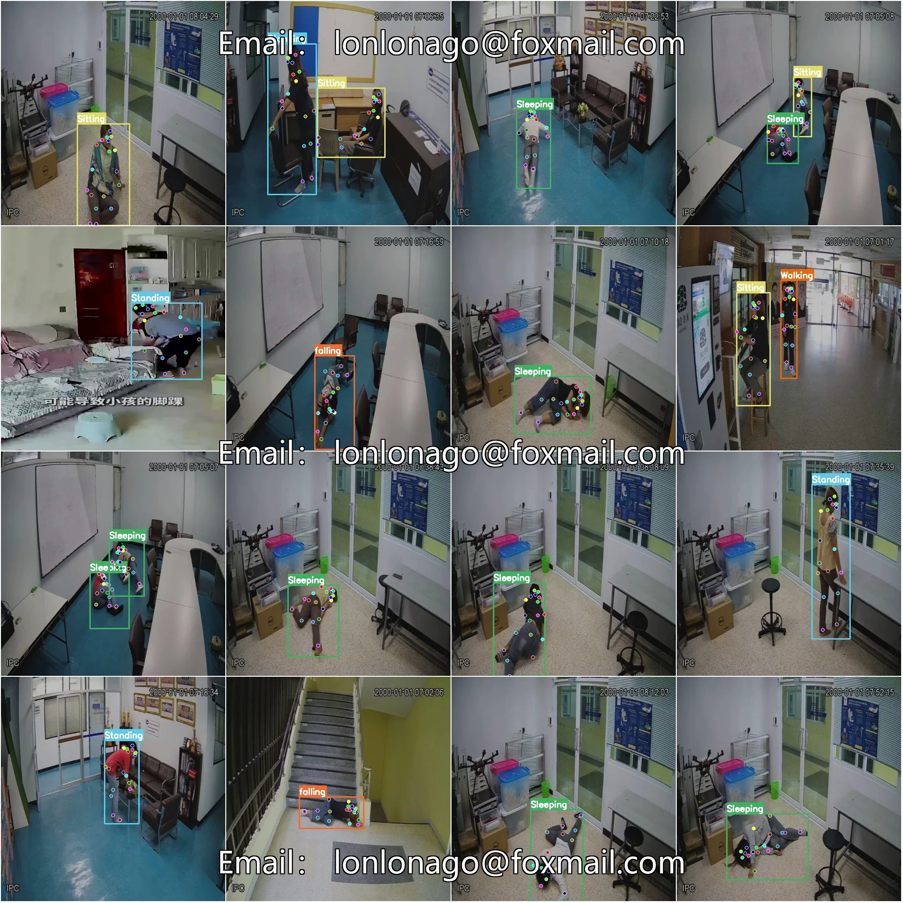

# Human Behavior Actions, Falling and Slipping Key Points Posture Estimation Detection Dataset COCO+YOL

## Body

Human Behavior and Actions: Flip, Fall, and Landing Key Points Posture Estimation Detection Dataset COCO+YOLO Format - 7770 Images in 6 Categories with 18 Key Points
Tips: Due to the dataset's replicability, please confirm compliance before purchasing.
Dataset Format: YOLO Keypoint Format (Note: This is not the YOLO format for object detection or segmentation, but merely includes JPG images along with corresponding YOLO format TXT files.)
Number of Images (JPG File Count): 7770
Number of Annotations (TXT File Count): 7770
Training Set Count: 7270
Validation Set Count: 500
Test Set Count: 0
Number of Annotation Categories: 6

Annotation category name: ['Sitting', 'Sleeping', 'Standing', 'Walking', 'Waving Hands', 'falling']
Number of key points annotated: 18

Key Point Names: ["Nose", "Neck", "R.Shoulder", "R.Elbow", "R.Wrist", "L.Shoulder", "L.Elbow", "L.Wrist", "R.Hip", "R.Knee", "R.Ankle", "L.Hip", "L.Knee", "L.Ankle", "R.Eye", "L.Eye", "R.Ear", "L.Ear"]
Number of Boxes per Category
Sitting (Standing) = 2000
Sleeping (Standing) = 2422
Standing (Standing) = 2246

Walking (Frames) = 2570
Waving Hands (Frames) = 96
Falling (Frames) = 2322
Total Frames = 11656
Image Resolution: 640x640
Important Note: The dataset has been split into training, validation, and test sets, which can be directly used for training Yolov5-pose, Yolov8-pose, Yolov11-pose, or Yolov26-pose.
Special Remark: This dataset does not guarantee the accuracy of the trained models or weight files.

## Images

## Payment

Here is a pay link on Stripe ( https://buy.stripe.com/3cs8yP7sY87d0vu9AB ). Please contact me lonlonago@foxmail.com after funding $89, and I will send you a complete data files , thank you!

